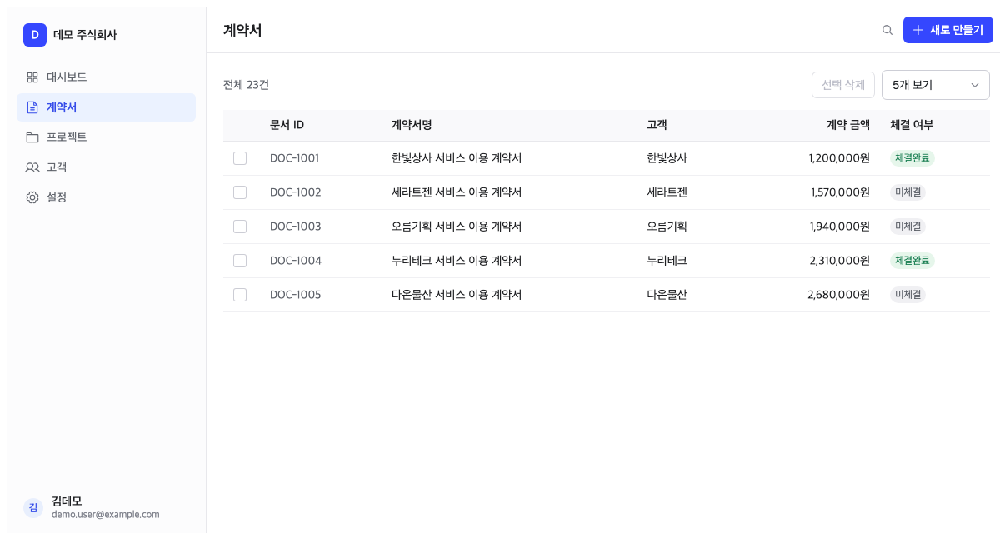

# NEXT 15기 x Lattice 기업 과제 데모 페이지

NEXT 15기 x Lattice 기업 과제에서 만든 피드백 채팅 SDK를 붙여 볼 예시 고객사 페이지입니다. 래티스 디자인시스템으로 만든 React 화면 한 장을 빌드해 둔 정적 페이지입니다.



## 사용 방법

1. 이 레포를 포크합니다.
2. 루트의 `index.html` 아래쪽 주석을 풀고, 스크립트 주소를 팀 SDK 주소로 바꿉니다.

```html
<script src="https://팀이름.vercel.app/sdk.js"></script>
```

3. SDK 앱과 **다른 주소**에 배포합니다. Vercel에서 새 프로젝트를 만들어 포크한 레포를 연결하면 됩니다. 빌드 과정이 없는 정적 페이지라 설정은 기본값 그대로 두면 됩니다.

## 로컬에서 보기

```bash
npx serve .
```

## 알아 둘 것

- 로그인한 사용자 정보는 `window.DEMO_USER`에 있습니다. SDK에 사용자 정보를 넘길 때 쓰세요.
- 바꿀 곳은 루트 `index.html`의 SDK 스크립트 한 줄뿐입니다. `assets/`는 빌드 결과물이라 수정하지 않습니다.
- 화면에는 일부러 넣어 둔 불편한 동작이 있습니다. 직접 써 보면서 피드백을 보내 보세요.
- `source/`는 이 페이지의 React 소스입니다. 래티스 디자인시스템 패키지가 비공개라 직접 빌드할 수는 없고, 참고용입니다.
